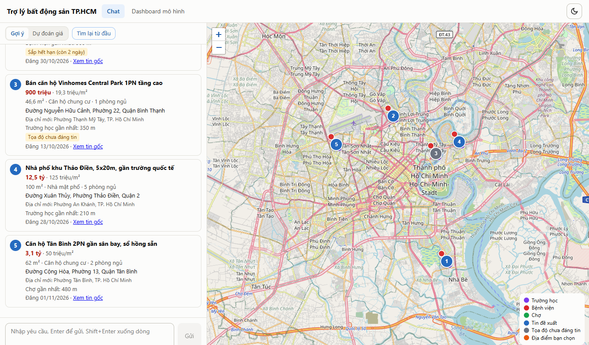
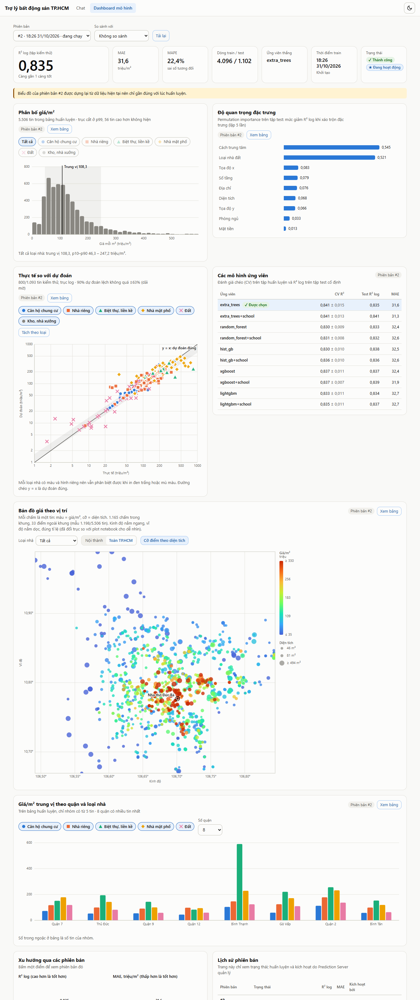
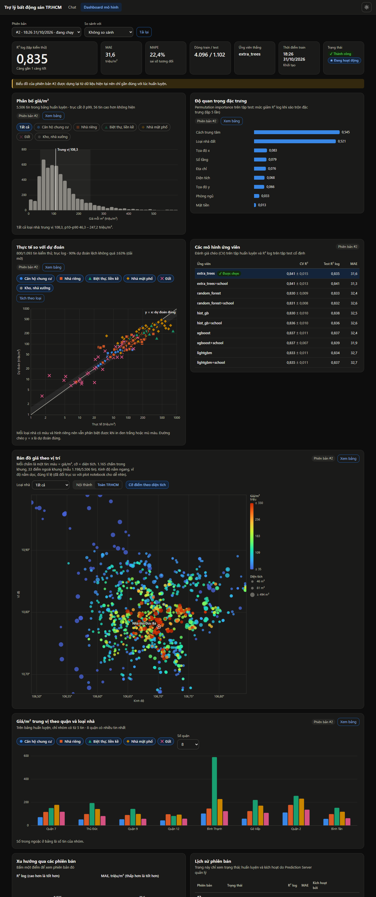
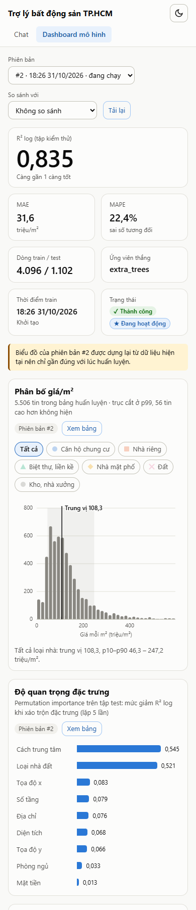

# Multi-Agent RAG and Prediction for Housing Prices

Chatbot tư vấn bất động sản **TP.HCM (địa giới cũ, trước sáp nhập 2025)** dùng dữ liệu tin đăng từ
batdongsan.com.vn. Hai chế độ chạy trên cùng một dữ liệu:

- **Gợi ý (RAG / Hybrid Search):** lọc cứng bằng SQL + PostGIS, sắp xếp bằng vector embedding
  (bge-m3) và từ khóa, trả về Top 5 kèm bản đồ.
- **Dự đoán giá:** mô hình ExtraTrees dự đoán giá rao bán/m² từ loại nhà, quận, diện tích, vị trí,
  khoảng cách trung tâm và số trường học quanh nhà.

> Giá dự đoán là giá rao bán tham khảo từ tin đăng, không phải giá giao dịch thực tế và không phải
> tư vấn pháp lý hoặc tài chính.

## Kiến trúc tóm tắt

```text
batdongsan.com.vn ──crawl──► data.json ──pipeline──► PostgreSQL (PostGIS + pgvector)
                                                       │  listings, pois, địa chỉ, embeddings
        Kaggle (bge-m3 embedding API) ◄───embed────────┤
                                                       ▼
 Frontend (React/Vite) ◄──HTTP──► Backend FastAPI ──► OpenAI (hiểu câu) · Goong (geocode)
                                       └──► models/price_rf.joblib (dự đoán giá)
```

LLM chỉ **hiểu câu** (trích trường, ý định); mọi câu trả lời do code dựng từ số liệu thật.
Chi tiết: [docs/chatbot.md](docs/chatbot.md), [docs/architecture.md](docs/architecture.md).

## Giao diện

**Chat gợi ý nhà** (Top 5 kèm bản đồ, chế độ "Dự đoán giá" ở cùng khung chat):



**Dashboard mô hình** (dữ liệu thật của phiên bản đang chạy: phân bố giá, thực tế so với dự đoán, độ quan trọng đặc trưng, bản đồ giá theo vị trí, giá trung vị theo quận × loại nhà, lịch sử phiên bản):



<details>
<summary>Chế độ tối và giao diện điện thoại</summary>





</details>

> Ảnh chat chụp với dữ liệu mẫu của mock server (`npm run mock`) để không gọi OpenAI; ảnh dashboard chụp với
> dữ liệu thật từ Prediction Server.

## Cấu trúc dự án

```text
.
├── address_data/                   # Địa chỉ batdongsan (nguồn chuẩn cho các bảng địa chỉ)
├── data/listings/                  # Đầu ra làm sạch tin đăng (pipeline)
├── docs/                           # Tài liệu: kiến trúc, database, chatbot, API, spec từng giai đoạn
├── tools/                          # Script phân tích / import POI (một số đã lỗi thời, xem ghi chú trong file)
├── src/
│   ├── crawl/
│   │   ├── crawlProperties/        # Crawler tin đăng (Selenium + undetected-chromedriver)
│   │   └── dataUltilities/         # CSV tiện ích: trường học, bệnh viện, chợ
│   ├── pipeline/                   # Làm sạch → nạp DB → FK địa chỉ → POI → embedding
│   ├── notebook/
│   │   ├── predictionEDA/          # EDA + thí nghiệm mô hình giá (notebook.ipynb)
│   │   └── kaggle/                 # embedding_server.ipynb (API bge-m3 trên Kaggle)
│   ├── tests/                      # Test pipeline
│   └── web/
│       ├── housing-backend/        # FastAPI, Alembic, script nạp dữ liệu, mô hình giá (models/)
│       └── housing-frontend/       # React 18 + TypeScript + Vite + Leaflet
├── pyproject.toml / uv.lock        # Môi trường Python dùng chung (.venv ở thư mục gốc)
└── DoAn2.md                        # Đề cương đồ án
```

## 0. Chuẩn bị môi trường (làm một lần)

**Yêu cầu:** Windows 11, Python 3.13, Node.js 18+, PostgreSQL 16+ có **PostGIS** và **pgvector**
(cài hướng dẫn trong [docs/setup-postgis-pgvector.md](docs/setup-postgis-pgvector.md), hoặc dùng
`docker compose up -d db` trong `src/web/housing-backend`), Google Chrome (để crawl).

```powershell
# Tại thư mục gốc dự án
python -m venv .venv
.\.venv\Scripts\python.exe -m pip install -e src/web/housing-backend
.\.venv\Scripts\python.exe -m pip install -r src/crawl/crawlProperties/requirements.txt
.\.venv\Scripts\python.exe -m pip install xgboost lightgbm seaborn tabulate   # chỉ cần cho notebook
```

> Trong repo này `.venv` gốc được quản lý bằng `uv`. **Đừng chạy `uv add`/`uv sync` khi notebook hoặc
> backend đang chạy** (Windows khóa file DLL của numpy) và nhớ `uv sync` sẽ gỡ gói không khai báo
> trong `pyproject.toml`. Không dùng `uv run` trong `src/web/housing-backend` (bị Application Control chặn).

**File `.env` ở thư mục gốc** (đọc bởi backend và pipeline, **không commit**):

```ini
DATABASE_URL=postgresql+asyncpg://postgres:<mật khẩu>@localhost:5432/housing_dev
OPENAI_API_KEY=sk-...           # LLM hiểu câu (mặc định gpt-4o-mini)
OPENAI_MODEL=gpt-4o-mini
GOONG_API_KEY=...               # geocode địa chỉ cho mode dự đoán giá (1.000 lượt/ngày)
EMBEDDING_API_URL=https://xxxx.trycloudflare.com   # in ra từ notebook Kaggle, đổi mỗi phiên
EMBEDDING_API_KEY=...
```

Quy ước DB: `housing` là DB thật, **không phá**; thử nghiệm trên `housing_dev`.

Biến thể thường dùng trong PowerShell (thay mật khẩu của bạn):

```powershell
$env:PYTHONIOENCODING = 'utf-8'
$env:DATABASE_URL = 'postgresql+asyncpg://postgres:<mật khẩu>@localhost:5432/housing_dev'
$PY = (Resolve-Path .\.venv\Scripts\python.exe).Path
```

---

## 1. Cào dữ liệu web (crawler)

Crawler nằm ở `src/crawl/crawlProperties/`. Chạy **từ thư mục đó**:

```powershell
cd src\crawl\crawlProperties

# Bước 1: lấy link tin đăng (trang 1–25, thêm vào linkNhaDat.txt, không ghi link trùng)
& $PY .\1_GetLinkNhaDat.py --start-page 1 --end-page 25 --workers 5

# Bước 2: trích xuất chi tiết từng link → data.json (JSON Lines, ghi nối tiếp)
& $PY .\2_LocDataLink.py --start-index 1 --workers 5 --retries 3

# Hoặc chạy cả hai bước
& $PY .\crawl_data.py
```

| Tham số | Ý nghĩa |
|---|---|
| `--start-page`, `--end-page` | Phạm vi trang (tính cả hai đầu) |
| `--start-index`, `--limit` | Vị trí link bắt đầu (đếm từ 1) và số link tối đa; dùng để chạy thử/tiếp tục |
| `--workers` | Số Chrome chạy đồng thời |
| `--retries`, `--launch-delay` | Số lần thử lại, khoảng cách mở Chrome (giây) |

Lưu ý:

- `data.json` dùng chế độ **append**: chạy lại cùng phạm vi sẽ sinh bản ghi trùng (pipeline ở bước 2 tự
  loại trùng theo `listing_id`). Link lỗi/bị loại ghi vào `data_errors.json`.
- Dừng giữa chừng không mất dữ liệu đã ghi; muốn tiếp tục thì chọn `--start-index`/`--start-page` mới.
- Chrome cần Internet; ChromeDriver được tải tự động.
- Tôn trọng điều khoản của website, đừng tăng `--workers` quá cao.

Chi tiết: [src/crawl/crawlProperties/README.md](src/crawl/crawlProperties/README.md),
[docs/crawler.md](docs/crawler.md); cấu trúc HTML trong `src/crawl/crawlProperties/analysis/`.

---

## 2. Đẩy dữ liệu vào database

Chạy lần lượt (mỗi bước chạy lại được, kết quả không nhân đôi).

### 2.1 Tạo schema và nạp địa chỉ

```powershell
cd src\web\housing-backend
& $PY -m alembic upgrade head          # tạo extension, bảng ở schema public, hàm SQL (nearby, refresh_*)
& $PY scripts\seed_address.py          # nạp address_data/ vào 7 bảng địa chỉ + ward_mappings
# Chỉ khi address_data/ chưa có sg_*_wards/streets.json:
# & $PY scripts\fetch_bds_address.py
```

Alembic cần `DATABASE_URL` (trỏ `housing_dev`). `alembic.ini` chỉ được chứa ký tự ASCII trên Windows.

### 2.2 Nạp tiện ích (POI: trường học, bệnh viện, chợ)

CSV nguồn ở `src/crawl/dataUltilities/` (`poi_schools.csv` 4.660 dòng, `poi_hospitals.csv` 376,
`poi_markets.csv` 231). Hiện dữ liệu POI nằm sẵn trong DB `housing` (schema `amenities`, kèm cột
`geom` PostGIS) và được chép sang bảng `public.pois` của DB đích bằng:

```powershell
& $PY scripts\migrate_legacy_data.py `
    --source-url postgresql://postgres:<mật khẩu>@localhost:5432/housing `
    --target-url postgresql://postgres:<mật khẩu>@localhost:5432/housing_dev
& $PY scripts\import_universities.py   # (tuỳ chọn) thêm đại học/cao đẳng, cho tìm "gần <tên trường>"
```

Nếu DB `housing` chưa có `amenities.*`, import CSV bằng `tools/import_pois.py`
(đọc [src/crawl/dataUltilities/README.md](src/crawl/dataUltilities/README.md); script này được ghi là
lỗi thời nên cần kiểm tra đường dẫn CSV trước khi chạy).

### 2.3 Nạp tin đăng từ dữ liệu crawl

Tại **thư mục gốc**:

```powershell
cd ..\..\..
& $PY -m src.pipeline --input src\crawl\crawlProperties\data.json --output-dir data\listings
```

Pipeline làm: làm sạch → nạp `listings` (upsert) → điền FK địa chỉ → tính số POI 1 km/3 km →
(tuỳ chọn) embedding. Ghép nhiều file crawl: `--input a.json b.json`. Đầu ra làm sạch ở
`data/listings/` (`listings_clean.jsonl`, `listings_rejected.jsonl`, `cleaning_report.json`).
Chi tiết, số liệu mẫu và test: [src/pipeline/README.md](src/pipeline/README.md).

### 2.4 Embedding (cần server embedding đang chạy, xem mục 5)

```powershell
& $PY -m src.pipeline --embed-only      # chỉ embed tin đã có trong DB; tin không đổi thì bỏ qua
```

Kiểm tra nhanh số dòng: bảng `listings`, `listing_spatial_features`, `listing_embeddings`.

---

## 3. Chạy mô hình dự đoán giá và lưu vào backend

### 3.1 Thí nghiệm (tuỳ chọn): notebook

`src/notebook/predictionEDA/notebook.ipynb` làm EDA và so sánh nhiều mô hình/đặc trưng (đặc trưng POI
được cache ở `data/poi_features.csv`; đặt `FORCE_RECOMPUTE = True` để tính lại từ DB). Chọn kernel
`.venv` của dự án. Khoảng 4–10 phút cho mỗi mục thí nghiệm; nên **Restart kernel** khi xong vì mục thí
nghiệm dùng nhiều RAM (vài GB).

### 3.2 Train mô hình dùng cho chatbot

Mô hình của chatbot được train bằng script trong backend, kết quả lưu thẳng vào `models/`:

```powershell
cd src\web\housing-backend
$env:PYTHONPATH = '.'
& $PY scripts\train_price_model.py
```

Script đọc `data/price_training.csv`, đếm số trường quanh từng tin bằng PostGIS (cần DB có bảng
`pois`), train **ExtraTrees 200 cây** trên 11 đặc trưng, in RMSE/MAE/R² rồi lưu:

```text
src/web/housing-backend/models/price_rf.joblib          # mô hình (~250 MB, không commit)
src/web/housing-backend/models/price_rf.metrics.json    # R², median giá theo quận/loại dùng để giải thích
```

Chưa train thì mode dự đoán trả HTTP 503, mode gợi ý vẫn chạy. Muốn quay về mô hình RandomForest cũ:
chép `price_rf.joblib.rf_old` / `price_rf.metrics.json.rf_old` đè lên hai file trên (và bỏ hai cột trường
học khỏi `FEATURES` trong `app/services/prediction/predictor.py`).

Kết quả hiện tại: R² trên log giá/m² ≈ 0,807, R² trên giá/m² ≈ 0,571, MAE ≈ 32,9 triệu/m².

---

## 4. Chạy backend

```powershell
cd src\web\housing-backend
& $PY -m uvicorn app.main:app --port 8000        # Swagger: http://127.0.0.1:8000/docs
```

Backend đọc `.env` ở thư mục gốc (rồi `.env` cạnh backend nếu có). CORS mặc định cho phép
`http://localhost:5173`; đổi bằng biến `CORS_ORIGINS`. Endpoint chính: `POST /api/v1/chat`
(`mode: "recommendation" | "prediction"`), `GET /api/v1/recommend/map`, `POST /api/v1/reset`.
Chi tiết request/response: [docs/api.md](docs/api.md).

Test (không gọi OpenAI/Goong):

```powershell
& $PY -m pytest tests -q
uvx ruff check app scripts
```

---

## 5. Chạy "server LLM"

Hệ thống dùng hai dịch vụ ngoài, **không chạy model cục bộ**:

**a) LLM hiểu câu — OpenAI.** Chỉ cần `OPENAI_API_KEY` (và `OPENAI_MODEL`) trong `.env`. Mỗi lượt chat
gọi API nên tốn phí nhỏ; test tự động dùng LLM giả. OpenAI lỗi → backend trả 503.

**b) Embedding bge-m3 — server trên Kaggle (GPU).** Dùng cho `--embed` của pipeline và cho sắp xếp
vector khi gợi ý. Khi server tắt, gợi ý vẫn chạy nhưng sắp theo ngày đăng (trạng thái `degraded`).

1. Vào Kaggle, tạo notebook từ `src/notebook/kaggle/embedding_server.ipynb`.
2. *Settings → Accelerator:* GPU T4 x2 hoặc P100. *Settings → Internet:* On.
3. (Nên làm) *Add-ons → Secrets:* tạo `EMBEDDING_API_KEY` với một chuỗi ngẫu nhiên dài.
4. **Run All** ở chế độ chỉnh sửa (không dùng *Save Version*).
5. Cell 4 in ra `EMBEDDING_API_URL=...` và `EMBEDDING_API_KEY=...`; chép vào `.env` ở gốc dự án.
6. Xong việc thì *Stop session* để không tốn quota GPU.

> URL (Cloudflare tunnel) **đổi mỗi lần chạy lại**, nhớ cập nhật `.env`. Đừng chia sẻ notebook kèm
> output vì output chứa API key. Kiểm tra: `GET <EMBEDDING_API_URL>/health`.

---

## 6. Chạy frontend

```powershell
cd src\web\housing-frontend
npm install
npm run dev            # http://localhost:5173
```

- Mặc định gọi backend thật tại `http://localhost:8000` (đặt `VITE_API_URL` trong `.env.local` để đổi).
- Chạy không cần backend: `npm run mock` (cổng 8001) rồi đặt `VITE_API_URL=http://localhost:8001`.
- Bản đồ dùng OpenStreetMap; muốn dùng tile Goong đặt `VITE_GOONG_MAPTILES_KEY`
  (khóa riêng cho frontend, không dùng `GOONG_API_KEY` của backend).
- Nút "Gợi ý | Dự đoán giá" đổi chế độ. `npm run build` (TypeScript strict + Vite), `npm test` (Vitest).

### Thứ tự chạy tóm tắt cho một máy mới

1. Cài Postgres + PostGIS + pgvector, tạo DB `housing_dev`, tạo `.env` (mục 0).
2. `alembic upgrade head` → `seed_address.py` → nạp POI (mục 2.1–2.2).
3. Crawl (mục 1) → `python -m src.pipeline` (mục 2.3).
4. Bật server Kaggle → `--embed-only` (mục 5, 2.4).
5. `train_price_model.py` (mục 3.2).
6. Chạy backend (mục 4) và frontend (mục 6).

---

## 7. Chạy Prediction Server (dự đoán giá, nạp tin, tự retrain)

Dịch vụ FastAPI độc lập (`src/prediction_server/`), dùng chung PostgreSQL với backend. Nhận tin
crawl thô, làm sạch và nạp `listings`, tự retrain khi đủ tin mới, tự chọn mô hình tốt nhất và nạp
nóng (không restart). Spec: [docs/tasks/prediction-server.md](docs/tasks/prediction-server.md).

```text
src/prediction_server/
  main.py            # dựng app, lifespan, gắn router
  core/              # settings, security (X-API-Key), container
  db/                # connection, runs (SQL của price_model_runs)
  api/               # deps.py, router.py, routers/{health,predict,ingest,jobs,retrain,models}.py
  schemas/           # request/response theo nhóm
  services/          # ingest, training (trainer, policy, retrain), registry, prediction, jobs
  tests/             # api/, services/, conftest.py
```

Chuẩn bị (một lần): `alembic upgrade head` trong `src/web/housing-backend` (migration 0005 tạo bảng
`price_model_runs`), và `uv pip install --python <.venv python> python-multipart` nếu chưa có
(xem `src/prediction_server/requirements.txt`). Thêm vào `.env` gốc (có mặc định hợp lý, chỉ khóa là bắt buộc):

```dotenv
DATABASE_URL=postgresql://postgres:<mật khẩu>@localhost:5432/housing_dev   # mặc định housing_dev
PREDICTION_SERVER_API_KEY=<khóa tự đặt>
MODELS_DIR=models                 # nơi ghi price_run_<id>.joblib (không commit)
RETRAIN_MIN_NEW=200               # retrain khi có >= 200 tin mới...
RETRAIN_MIN_RATIO=0.05            # ...hoặc >= 5% tổng số tin
RETRAIN_INTERVAL_HOURS=6          # lịch kiểm tra; 0 = tắt
PROMOTE_MIN_GAIN=0.002            # R² log hơn model cũ ít nhất chừng này
PROMOTE_MAX_REGRESSION=0.05       # MAE được tệ hơn model cũ tối đa 5%
KEEP_ARTIFACTS=5
MAX_INGEST_BYTES=20971520         # trần body của POST /ingest (vượt: 413)
```

```powershell
& $PY -m uvicorn src.prediction_server.main:app --port 8100     # tại thư mục gốc dự án
$h = @{ 'X-API-Key' = '<khóa>' }
Invoke-RestMethod http://localhost:8100/api/v1/health                      # không cần khóa
Invoke-RestMethod -Method Post http://localhost:8100/api/v1/predict -Headers $h -ContentType 'application/json' `
  -Body '{"property_code":2,"district_code":18,"area":80,"latitude":10.73,"longitude":106.72}'
Invoke-RestMethod -Method Post http://localhost:8100/api/v1/retrain -Headers $h   # ép retrain, trả job_id
Invoke-RestMethod http://localhost:8100/api/v1/models -Headers $h                 # lịch sử + bảng ứng viên
Invoke-RestMethod -Method Post http://localhost:8100/api/v1/models/3/activate -Headers $h   # rollback
```

`POST /ingest` nhận `{"records": [...]}` (tối đa 5.000 bản ghi) hoặc upload file JSON Lines
(`multipart`, trường `file`), trả `202 {job_id}`; xem kết quả ở `GET /jobs/{job_id}`. Chưa có model
thì server tự bootstrap khi đủ tin; trong lúc đó `/predict` trả 503.

Mỗi lần train lưu thêm `charts` (phân bố giá, scatter thực tế/dự đoán, độ quan trọng đặc trưng,
median quận × loại, ứng viên; ≤ 200 KB) vào `price_model_runs`: `GET /api/v1/models/{id|active}/charts`,
`POST /api/v1/models/{id}/charts/rebuild`; backend proxy ở `/api/v1/dashboard/models[/{id|active}]`.
Khởi động mà phiên bản đang chạy thiếu `charts` thì server tự dựng nền.

Backend chatbot gọi server khi đặt `PREDICTION_SERVER_URL=http://localhost:8100` và
`PREDICTION_SERVER_API_KEY` (timeout `PREDICTION_SERVER_TIMEOUT`, mặc định 3 giây); server lỗi thì tự
dùng mô hình cục bộ kèm cảnh báo. Test: `pytest src/prediction_server/tests` (tại thư mục gốc).
Phần lớn test chạy không cần DB; riêng `test_runs_schema.py` cần `DATABASE_URL` trỏ `housing_dev` (kèm
mật khẩu) đã `alembic upgrade head`, nếu không thì tự bỏ qua (skipped).

Tập test của mô hình chia cố định theo tin (`crc32(listing_id) % 5 == 0`) nên model cũ và mới so được
công bằng. Model train trước khi có luật này không có thông tin đó nên không so công bằng được: lần retrain
đầu sau nâng cấp luôn kích hoạt model mới (chuyển giao), từ lần sau so trực tiếp trên cùng test.

---

## Tài liệu

| Muốn biết | Đọc |
|---|---|
| Hai chatbot: kiến trúc, intent, chạy/test | [docs/chatbot.md](docs/chatbot.md) |
| Cách gọi API | [docs/api.md](docs/api.md) |
| Kiến trúc, quy ước dữ liệu | [docs/architecture.md](docs/architecture.md), [docs/data-contract.md](docs/data-contract.md) |
| Bảng/cột database, cài PostGIS/pgvector | [docs/database.md](docs/database.md), [docs/setup-postgis-pgvector.md](docs/setup-postgis-pgvector.md) |
| Backend + Alembic | [src/web/housing-backend/README.md](src/web/housing-backend/README.md) |
| Frontend | [src/web/housing-frontend/README.md](src/web/housing-frontend/README.md) |
| Pipeline làm sạch tin | [src/pipeline/README.md](src/pipeline/README.md), [docs/huong-dan-pipeline-lam-sach.md](docs/huong-dan-pipeline-lam-sach.md) |
| Trạng thái, việc dở, backlog | [docs/tasks/STATUS.md](docs/tasks/STATUS.md), [docs/jira-backlog.md](docs/jira-backlog.md) |
| Đề cương đồ án | [DoAn2.md](DoAn2.md) |

## Nguyên tắc dữ liệu

- Phạm vi địa lý: TP.HCM cũ. Không mở rộng sang Bình Dương, Bà Rịa – Vũng Tàu.
- Không suy đoán dữ liệu: không tự map địa chỉ cũ → mới, không tự điền trường thiếu.
- Lưu dữ liệu gốc nguyên văn (`8,6 tỷ`, `Quận 2`); chuẩn hóa là việc của pipeline.
- Không commit: dữ liệu crawl, log lỗi, profile Chrome, `.env`, thư mục `models/`.
