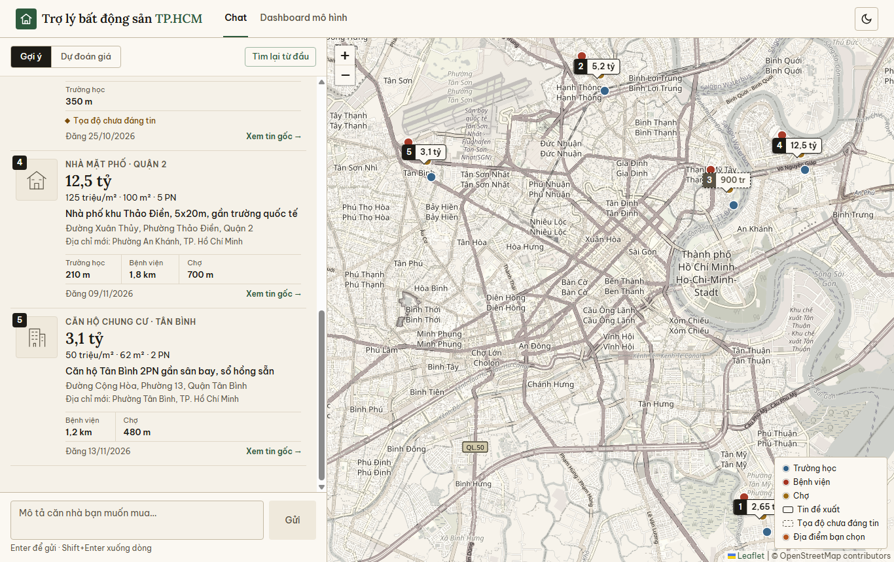
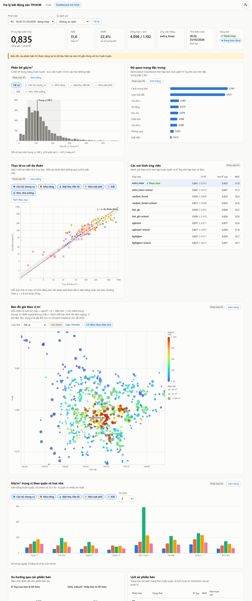

# Multi-Agent RAG and Prediction for Housing Prices

Chatbot tư vấn bất động sản **TP.HCM (địa giới cũ, trước sáp nhập 2025)** từ tin đăng batdongsan.com.vn.
Hai chế độ trên cùng một dữ liệu:

- **Gợi ý (RAG):** lọc cứng bằng SQL + PostGIS, xếp hạng bằng vector (bge-m3) và từ khóa, trả Top 5 kèm bản đồ.
- **Dự đoán giá:** mô hình ExtraTrees dự đoán giá rao bán/m² từ loại nhà, quận, diện tích, vị trí, số trường học quanh nhà.

> Giá dự đoán là giá rao bán tham khảo, không phải giá giao dịch, không phải tư vấn pháp lý/tài chính.

```text
batdongsan ─crawl─► data.json ─pipeline─► PostgreSQL (Docker: PostGIS + pgvector)
                                              ▲                    ▲
        Kaggle (embedding bge-m3) ──embed─────┘                    │
 Frontend (React) ◄─► Backend (FastAPI) ──► OpenAI · Goong         │
                         └──► Prediction Server (FastAPI) ─────────┘  (nạp tin, tự retrain, dự đoán)
```

LLM chỉ **hiểu câu**; câu trả lời do code dựng từ số liệu thật. Chi tiết: [docs/chatbot.md](docs/chatbot.md),
[docs/architecture.md](docs/architecture.md).

<details>
<summary>Ảnh giao diện</summary>




(Ảnh chat chụp với dữ liệu mẫu của mock server; ảnh dashboard là dữ liệu thật.)
</details>

---

## Yêu cầu ban đầu

| Cần có | Dùng cho | Bắt buộc? |
|---|---|---|
| Windows 11, **Python 3.13**, **Node.js 18+** | chạy mã | có |
| **Docker Desktop** | chạy PostgreSQL + PostGIS + pgvector | có |
| **OpenAI API key** | chatbot hiểu câu (tốn phí nhỏ mỗi lượt chat) | có, để dùng chat |
| **Goong API key** | tìm tọa độ cho địa chỉ ở chế độ dự đoán giá | khuyến nghị |
| Tài khoản **Kaggle** (GPU) | server embedding bge-m3 | tuỳ chọn (thiếu thì gợi ý xếp theo ngày đăng) |
| Google Chrome | crawler | chỉ khi tự crawl |

**Quy ước chung** (giống nhau ở mọi tài liệu):

| Mục | Giá trị |
|---|---|
| Database | Docker, container `housing-postgres`, cổng **5433**, user `postgres` |
| DB | `housing_dev` = DB làm việc; `housing` = DB cũ, **chỉ đọc** |
| File `.env` | mỗi thành phần một file riêng (bảng ở bước 1), không có `.env` chung |
| File backup | `backup\housing_dev_YYYYMMDD.dump`, `backup\housing_YYYYMMDD.dump` |
| Python | `.venv` ở thư mục gốc; lệnh dùng biến `$PY` (định nghĩa ở đầu mỗi khối lệnh) |

Mọi lệnh viết cho **PowerShell**, chạy **tại thư mục gốc dự án** trừ khi ghi khác. Postgres cài sẵn trên Windows
(cổng 5432) là bản cũ, không dùng nữa.

---

## Chạy toàn bộ bằng Docker (một lệnh)

Cách nhanh nhất, và **không bị Windows Smart App Control chặn** `scikit-learn`/`asyncpg` (mọi thứ chạy trong Linux).
Cần Docker Desktop và 4 file `.env` (bảng ở bước 1 bên dưới; DB đã có dữ liệu như bước 2–3).

```powershell
# tại thư mục gốc dự án
docker compose up -d --build
```

| Service | Địa chỉ | Ghi chú |
|---|---|---|
| Web (frontend) | http://localhost:8080 | nginx, chuyển `/api` sang backend |
| Backend | http://localhost:8000/docs | đọc `src/web/housing-backend/.env` |
| Prediction Server | http://localhost:8100/docs | đọc `src/web/prediction_server/.env`, mô hình ở `models/` |
| Giao diện pipeline | http://localhost:8200 | đọc `src/pipeline/.env`, lịch sử ở `output/pipeline_runs/` |
| PostgreSQL | `localhost:5433` | container `housing-postgres`, volume cũ giữ nguyên |

- Service `migrate` chạy `alembic upgrade head` một lần rồi thoát, trước khi các service khác khởi động.
- `DATABASE_URL` trong các `.env` vẫn để `localhost:5433`; trong Docker tự đổi thành `db:5432`.
- Xem log: `docker compose logs -f backend`. Dừng: `docker compose down` (không mất dữ liệu; **không** thêm `-v`).
- Sửa code thì chạy lại `docker compose up -d --build`. Thư viện Python ghim ở `docker/requirements.txt`
  (đúng phiên bản `.venv` để nạp được file `.joblib`).

## Chạy dự án trên máy mới (từng bước)

> ✅ = **bỏ qua được nếu đã làm** (có lệnh kiểm tra).

### 1. Cài thư viện Python, Node và tạo các file `.env`
✅ Bỏ qua nếu `.venv\Scripts\python.exe`, `src\web\housing-frontend\node_modules` và 4 file `.env` (bảng dưới) đã có.

```powershell
python -m venv .venv
$PY = (Resolve-Path .\.venv\Scripts\python.exe).Path
& $PY -m pip install -e src/web/housing-backend -r src/requirements.txt -r src/web/prediction_server/requirements.txt -r src/crawl/crawlProperties/requirements.txt
cd src\web\housing-frontend; npm install; cd ..\..\..
Copy-Item src\web\housing-backend\.env.example src\web\housing-backend\.env
Copy-Item src\web\prediction_server\.env.example src\web\prediction_server\.env
Copy-Item src\pipeline\.env.example src\pipeline\.env
Copy-Item src\web\housing-frontend\.env.example src\web\housing-frontend\.env
```

Không dùng `uv sync`/`uv add`/`uv run` (làm mất gói không khai báo trong `pyproject.toml`). Rồi sửa từng file:

| File | Biến cần điền |
|---|---|
| `src/web/housing-backend/.env` | `POSTGRES_PASSWORD`, `DATABASE_URL`, `OPENAI_API_KEY`, `GOONG_API_KEY`, `EMBEDDING_API_URL/KEY`, `PREDICTION_SERVER_API_KEY` |
| `src/web/prediction_server/.env` | `DATABASE_URL`, `PREDICTION_SERVER_API_KEY` |
| `src/pipeline/.env` | `DATABASE_URL`, `EMBEDDING_API_URL/KEY` (chỉ khi embed) |
| `src/web/housing-frontend/.env` | `VITE_API_URL` (mặc định `http://localhost:8000`) |

- Ba `DATABASE_URL` cùng trỏ `localhost:5433/housing_dev` với **cùng mật khẩu** = `POSTGRES_PASSWORD` (file mẫu đều
  dùng `doi_mat_khau`). Backend dùng dạng `postgresql+asyncpg://...`, hai nơi còn lại `postgresql://...`.
- `PREDICTION_SERVER_API_KEY` ở backend và Prediction Server **phải giống nhau** (tự đặt một chuỗi ngẫu nhiên).
- Mỗi dịch vụ chỉ đọc `.env` của chính nó.

### 2. Bật database (Docker)
✅ Bỏ qua nếu `docker ps` thấy `housing-postgres ... (healthy)`.

```powershell
cd src\web\housing-backend; docker compose up -d db; cd ..\..\..
do { Start-Sleep 3 } until ((docker exec housing-postgres pg_isready -h 127.0.0.1 -U postgres -d housing_dev) -match 'accepting')
```

Lần đầu tự build image (cần Internet, vài phút). Chi tiết, sự cố: [docs/setup-docker-postgres.md](docs/setup-docker-postgres.md) mục 1–3.

### 3. Nạp dữ liệu vào DB: chọn một đường
✅ Bỏ qua nếu lệnh này in số lớn hơn 0:
```powershell
docker exec housing-postgres psql -U postgres -d housing_dev -At -c "select count(*) from listings"
```

- **Đã có backup trong `backup\`** (`housing_dev_YYYYMMDD.dump`, có thể kèm `housing_YYYYMMDD.dump`): khôi phục theo
  [docs/setup-docker-postgres.md](docs/setup-docker-postgres.md) **mục 4A** (4 lệnh mỗi DB). Xong là đủ bảng, địa
  chỉ, POI, tin, vector; **bỏ qua bước 4–6** và chép lại `models\` từ `backup\models_YYYYMMDD\`.
- **Chưa có backup:** làm **mục 4B** (Alembic tạo bảng → nạp địa chỉ → nạp POI), rồi bước 4–6 dưới đây.
  ⚠️ Hiện nạp địa chỉ bị lỗi đường dẫn và nạp POI cần DB `housing` cũ (chi tiết trong mục 4B).

### 4. Lấy dữ liệu tin đăng (crawl)
✅ Bỏ qua nếu đã có file dữ liệu trong `src\pipeline\input\` (hiện có `data.json`, `data14-11.json`).

```powershell
$PY = (Resolve-Path .\.venv\Scripts\python.exe).Path
cd src\crawl\crawlProperties
& $PY .\1_GetLinkNhaDat.py --start-page 1 --end-page 25     # lấy link → linkNhaDat.txt
& $PY .\2_LocDataLink.py --workers 5                        # trích chi tiết → data.json (ghi nối tiếp)
cd ..\..\..
```

Cần Google Chrome. Dừng giữa chừng không mất dữ liệu; chạy tiếp bằng `--start-page`/`--start-index` mới. Chi tiết:
[src/crawl/crawlProperties/README.md](src/crawl/crawlProperties/README.md).

### 5. Làm sạch và nạp tin vào DB
✅ Bỏ qua nếu `select count(*) from listings` (lệnh ở bước 3) đã đủ tin.

```powershell
$PY = (Resolve-Path .\.venv\Scripts\python.exe).Path
& $PY -m src.pipeline --input src\pipeline\input\data.json src\pipeline\input\data14-11.json
```

Hoặc dùng giao diện kéo thả file: `& $PY -m src.pipeline.server` rồi mở http://127.0.0.1:8200 (chọn DB đích, bật/tắt
từng bước, chạy thử, lịch sử; xem [src/pipeline/README.md](src/pipeline/README.md#giao-diện-web-kéo-thả-file)).
Luôn truyền `--input` (một hoặc nhiều file, cách nhau dấu cách). Chạy lại hoặc nạp thêm file mới **không nhân đôi
và không xóa tin cũ**. Pipeline đọc `DATABASE_URL` trong `src\pipeline\.env`. Chi tiết, số liệu mẫu:
[src/pipeline/README.md](src/pipeline/README.md).

### 6. (Tuỳ chọn) Tạo embedding để gợi ý theo ngữ nghĩa
✅ Bỏ qua nếu chưa cần tìm theo ngữ nghĩa, hoặc `select count(*) from listing_embeddings` bằng số tin.

1. Mở Kaggle, tạo notebook từ `src/notebook/kaggle/embedding_server.ipynb`; *Settings →* Accelerator **GPU T4/P100**, Internet **On**; **Run All** (không dùng Save Version).
2. Cell 4 in `EMBEDDING_API_URL=...` và `EMBEDDING_API_KEY=...`: chép vào `src\pipeline\.env` **và** `src\web\housing-backend\.env`.
3. Chạy:
   ```powershell
   $PY = (Resolve-Path .\.venv\Scripts\python.exe).Path
   & $PY -m src.pipeline --embed-only
   ```
4. Xong thì *Stop session* trên Kaggle để khỏi tốn quota.

URL Kaggle **đổi mỗi lần chạy lại notebook**: cập nhật hai `.env` và khởi động lại backend. Server tắt thì lệnh
dừng ngay với thông báo, không ghi gì. Đừng chia sẻ notebook kèm output (có API key).

### 7. Mô hình dự đoán giá
✅ Bỏ qua nếu `GET http://localhost:8100/api/v1/health` (sau bước 8) báo đã có model đang hoạt động.

**Prediction Server tự train** lần đầu khi DB có đủ tin (≥ 300, khoảng 1–2 phút) và tự retrain khi có thêm tin
mới; file mô hình ghi vào `models\` ở thư mục gốc. Muốn train tay mô hình cục bộ (dự phòng cho backend):

```powershell
$PY = (Resolve-Path .\.venv\Scripts\python.exe).Path
cd src\web\housing-backend; $env:PYTHONPATH = '.'; & $PY scripts\train_price_model.py; cd ..\..\..
```

### 8. Chạy các dịch vụ (đúng thứ tự)

Thứ tự: **DB (bước 2) → Prediction Server → backend → frontend** (server embedding Kaggle ở bước 6 nếu dùng). Mỗi
dịch vụ một cửa sổ PowerShell, mở tại thư mục gốc dự án:

```powershell
# Cửa sổ 1: Prediction Server (http://localhost:8100/docs)
$PY = (Resolve-Path .\.venv\Scripts\python.exe).Path
& $PY -m uvicorn src.web.prediction_server.main:app --port 8100
```

```powershell
# Cửa sổ 2: Backend (Swagger: http://127.0.0.1:8000/docs)
$PY = (Resolve-Path .\.venv\Scripts\python.exe).Path
cd src\web\housing-backend; & $PY -m uvicorn app.main:app --port 8000
```

```powershell
# Cửa sổ 3: Frontend (http://localhost:5173)
cd src\web\housing-frontend; npm run dev
```

Backend đọc URL embedding và Prediction Server **lúc khởi động**; đổi `.env` thì khởi động lại. Thiếu Prediction
Server thì backend dùng mô hình cục bộ. Thử giao diện không cần backend: xem
[src/web/housing-frontend/README.md](src/web/housing-frontend/README.md) (mock).

> ⚠️ **Smart App Control:** nếu cửa sổ 1 hoặc 2 báo `DLL load failed ... An Application Control policy has blocked
> this file`, Windows đang chặn file `.pyd` không chữ ký trong `.venv`. Thử 14/11/2026 trên máy dự án: Prediction
> Server **bị chặn** (`scikit-learn`, ngay lúc khởi động); backend khởi động và truy vấn DB được (chế độ dự đoán giá
> cục bộ của backend cũng cần `scikit-learn`, chưa thử). Docker cho DB không giải quyết phần này; xem mục "Sự cố" cuối file.

### 9. Dùng thử
Mở **http://localhost:5173**: tab **Chat** (nút "Gợi ý | Dự đoán giá") và tab **Dashboard mô hình**.

---

## Thông tin tham khảo

**Prediction Server** (`src/web/prediction_server/`, cổng 8100). Mọi đường ghi cần header `X-API-Key`.

| Việc | Gọi |
|---|---|
| Trạng thái (không cần khóa) | `GET /api/v1/health` |
| Dự đoán | `POST /api/v1/predict` (`property_code`, `district_code`, `area`, `latitude`, `longitude`...) |
| Nạp tin thô | `POST /api/v1/ingest` (JSON `{"records": [...]}` hoặc upload JSON Lines) → `GET /api/v1/jobs/{id}` |
| Train lại ngay | `POST /api/v1/retrain` |
| Lịch sử phiên bản / quay lại bản cũ | `GET /api/v1/models`, `POST /api/v1/models/{id}/activate` |

Tự retrain khi đủ tin mới (mặc định ≥ 200 hoặc ≥ 5%), tự chọn mô hình tốt nhất theo CV và chỉ kích hoạt khi tốt hơn
bản đang chạy. Tập test chia cố định theo `listing_id` nên so sánh công bằng. Tham số và thiết kế: [docs/tasks/prediction-server.md](docs/tasks/prediction-server.md).

**Kiểm thử:**
```powershell
$PY = (Resolve-Path .\.venv\Scripts\python.exe).Path
& $PY -m pytest src\tests src\web\prediction_server\tests -q     # pipeline + Prediction Server
cd src\web\housing-backend; & $PY -m pytest tests -q; cd ..\..\..   # backend (không gọi OpenAI/Goong)
```
Một số test tự bỏ qua nếu chưa đặt `DATABASE_URL` trỏ `housing_dev`.

**Backup / khôi phục database:** backup (điều kiện bắt buộc, lệnh, kiểm tra bản backup) ở
[backup/README.md](backup/README.md); khôi phục ở [docs/setup-docker-postgres.md](docs/setup-docker-postgres.md) mục 4A.

**Lưu ý môi trường Python:** `.venv` gốc có thể bị `uv add`/`uv sync` làm mất gói không khai báo trong `pyproject.toml`
(và Windows khóa file DLL khi notebook/backend đang chạy). Cài gói bằng `pip` như bước 1, đừng chạy `uv sync`.

**Sự cố thường gặp:**

| Triệu chứng | Cách xử lý |
|---|---|
| `DLL load failed ... Application Control policy has blocked this file` khi chạy backend / Prediction Server / test | Smart App Control (Windows 11) chặn `.pyd` không chữ ký trong `.venv`. Cách xử lý (cần người dùng quyết): tắt Smart App Control (Windows Security → App & browser control), hoặc chạy backend trong Docker (`docker compose --profile api up -d` trong `src\web\housing-backend`, chưa kiểm thử) |
| `password authentication failed` | Mật khẩu trong `DATABASE_URL` khác `POSTGRES_PASSWORD` lúc tạo volume DB |
| `relation "listings" does not exist` | DB còn trống: làm bước 3 |
| Lỗi khác về Docker/khôi phục | [docs/setup-docker-postgres.md](docs/setup-docker-postgres.md#sự-cố-thường-gặp) |

**Notebook dự đoán giá:** `src/notebook/predictionEDA/notebook.ipynb` (EDA, so sánh mô hình, đặc trưng POI). Nên
Restart kernel khi xong vì dùng nhiều RAM.

## Cấu trúc thư mục

```text
data/address_data/          địa chỉ batdongsan (nguồn của seed_address.py)
docs/                       tài liệu và spec từng giai đoạn
backup/                     dump DB + models (không commit) + README
models/                     file mô hình giá của Prediction Server (không commit)
output/listings/            đầu ra bước làm sạch của pipeline (không commit)
src/crawl/                  crawler + CSV tiện ích (trường, bệnh viện, chợ)
src/pipeline/               làm sạch → nạp DB → POI → embedding; dữ liệu crawl đặt ở src/pipeline/input/
src/notebook/               predictionEDA (EDA, thí nghiệm) và kaggle (server embedding)
src/web/housing-backend/    FastAPI chatbot, Alembic, docker-compose của DB
src/web/prediction_server/  FastAPI dự đoán giá, nạp tin, tự retrain
src/web/housing-frontend/   React + TypeScript + Vite
```

## Tài liệu

| Muốn biết | Đọc |
|---|---|
| Chạy DB bằng Docker, nạp dữ liệu từ `backup/` | [docs/setup-docker-postgres.md](docs/setup-docker-postgres.md) |
| Kiến trúc, quy ước dữ liệu | [docs/architecture.md](docs/architecture.md), [docs/data-contract.md](docs/data-contract.md) |
| Hai chatbot, API | [docs/chatbot.md](docs/chatbot.md), [docs/api.md](docs/api.md) |
| Bảng/cột database | [docs/database.md](docs/database.md) |
| Backend, frontend, pipeline | [backend](src/web/housing-backend/README.md), [frontend](src/web/housing-frontend/README.md), [pipeline](src/pipeline/README.md) |
| Trạng thái, việc dở | [docs/tasks/STATUS.md](docs/tasks/STATUS.md) |
| Đề cương đồ án | [DoAn2.md](DoAn2.md) |

## Nguyên tắc dữ liệu

- Phạm vi: TP.HCM cũ, không mở rộng sang Bình Dương, Bà Rịa – Vũng Tàu.
- Không suy đoán dữ liệu (không tự map địa chỉ cũ → mới, không tự điền trường thiếu); lưu dữ liệu gốc nguyên văn.
- Không commit: `.env`, dữ liệu crawl, `models/`, file dump trong `backup/`.
