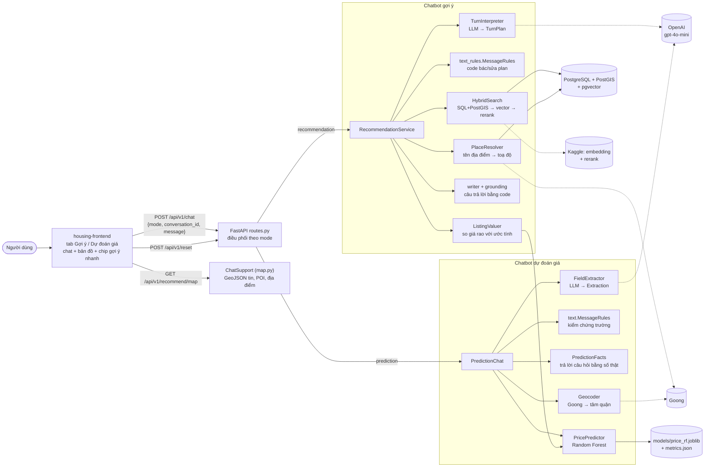
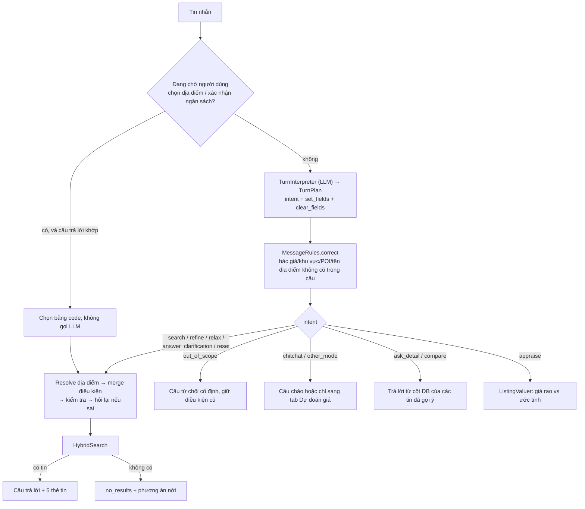
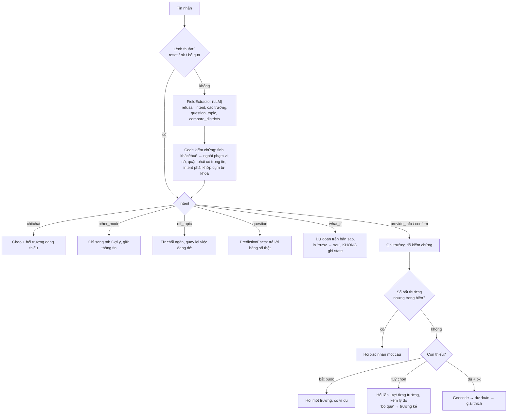
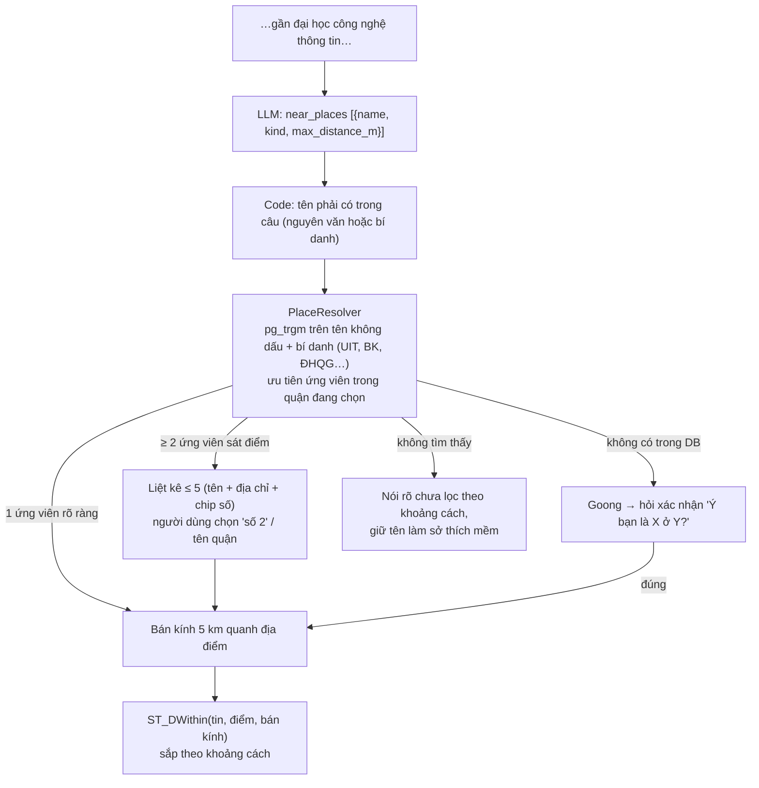

# Chatbot bất động sản TP.HCM

Tài liệu mô tả hai chatbot của đồ án: **Gợi ý** (tìm tin đang bán, RAG) và **Dự đoán giá**
(ước tính giá một bất động sản). Phạm vi: TP.HCM theo địa giới cũ (24 quận/huyện, trước sáp
nhập 2025); dữ liệu là tin đăng trên batdongsan.com.vn.

> Trạng thái: cập nhật 16/10/2026. Mục 6 (chat-intelligence) đã nghiệm thu đạt. Mục 7
> (địa điểm có tên) đạt ở lần chấm cuối, trừ lỗi Goong tỉnh giáp ranh đã sửa sau đó và chỉ
> kiểm bằng test (chưa chấm lại bằng reviewer). Chi tiết ở [STATUS.md](tasks/STATUS.md).

## 1. Nguyên tắc thiết kế

| Nguyên tắc | Cách thực hiện |
|---|---|
| LLM chỉ **hiểu câu**, không viết câu trả lời | LLM trả dữ liệu có cấu trúc (structured output): `TurnPlan` (gợi ý), `Extraction` (dự đoán). Mọi câu trả lời cho người dùng do code dựng từ số liệu thật |
| LLM chỉ **đề xuất**, code có quyền bác | Giá, quận, số, tên địa điểm LLM trích ra phải có trong tin nhắn của người dùng (kiểm bằng quy tắc tất định). Không có thì bỏ |
| Không bịa số | Giá, khoảng cách, median, R² lấy từ DB hoặc mô hình. Không có thì nói "chưa có" |
| Từ chối câu ngoài phạm vi | Tỉnh khác, thuê nhà, đấu giá, pháp lý/thuế, thơ/code/đổi vai: bị chặn bằng cả LLM lẫn code |
| Hỏi lại thay vì đoán | Thiếu/mơ hồ/mâu thuẫn/ngoài biên thì hỏi một câu, không áp dụng điều kiện đó |

Hệ quả: chatbot đồ án 1 (`api_gpt.py`) để LLM tự viết câu trả lời nên tự nhiên hơn, nhưng
có thể bịa lý do giá và dễ bị prompt injection. Bản này đánh đổi một phần "tự nhiên" lấy độ tin cậy.

## 2. Kiến trúc



Dùng chung hai chatbot: `assistant_text.py` (câu chào, chuyển chế độ, chip), `formatting.py`
(định dạng giá, khoảng cách), `openai_client.py`.

### Mã nguồn (trong `housing-backend/app/`)

| Thành phần | File |
|---|---|
| API | `api/v1/routes.py`, `api/deps.py` |
| Gợi ý | `services/recommendation/`: `interpreter.py` (LLM), `text_rules.py` (quy tắc), `service.py` (điều phối), `search.py` (truy vấn), `writer.py` + `grounding.py` (viết câu), `schemas.py` |
| Địa điểm có tên | `services/places.py` |
| So giá tin rao | `services/valuation.py` |
| Dự đoán | `services/prediction/`: `extractor.py` (LLM), `text.py` (quy tắc), `chat.py` (điều phối), `predictor.py` (mô hình), `geocoder.py`, `facts.py`, `schemas.py` |
| Bản đồ | `services/map.py` |

Trạng thái hội thoại giữ **trong bộ nhớ** (mất khi khởi động lại server). Chatbot dự đoán giữ tối
đa 1.000 hội thoại, bỏ cái lâu không dùng nhất.

## 3. API

Tất cả dưới `/api/v1`. Client chọn `mode`; backend không đoán.

| Endpoint | Việc |
|---|---|
| `POST /chat` | Một lượt chat. Body: `{mode: "recommendation"\|"prediction", conversation_id?, message, as_of?}`. `as_of` chỉ để cố định "hôm nay" khi test. Sai `mode` → 422 |
| `POST /reset` | `{conversation_id}`: xoá hội thoại ở cả hai mode ("Làm lại từ đầu") |
| `GET /recommend/map` | GeoJSON của các tin vừa gợi ý, POI quanh đó và địa điểm có tên đang lọc (kèm bán kính) |
| `POST /recommend/chat`, `/recommend/reset` | Bản riêng cho mode gợi ý |
| `GET /listings/{id}`, `GET /pois/nearby` | Tra cứu tin và POI |

OpenAI lỗi → 503 "Trợ lý tạm thời không phản hồi". Chưa train mô hình giá → mode prediction trả 503.

**Phản hồi mode gợi ý** (`ChatTurnResult`): `status` (`ok | need_clarification | out_of_scope |
no_results | answered`), `answer`, `summary` (câu trả lời bỏ khối từng tin), `constraints` (điều
kiện sau lượt), `listings` (≤ 5 tin), `relax_options`, `degraded` (embedding/rerank lỗi, đã dùng
phương án dự phòng), `suggestions`.

**Phản hồi mode dự đoán** (`PredictionTurn`): `status` (`collecting | ready | predicted |
out_of_scope`), `answer`, `summary`, `fields` (trường đã biết), `missing`, `prediction`
(`price_per_m2`, `total_price`, khoảng p10–p90, khoảng cách trung tâm, median quận), `suggestions`.

## 4. Chatbot Gợi ý

### 4.1 Một lượt



### 4.2 Intent

| Intent | Ví dụ | Xử lý |
|---|---|---|
| `search` | "Căn hộ Quận 7 dưới 3 tỷ" | Điều kiện mới, tìm |
| `refine` | "rẻ hơn chút", "thêm gần chợ" | Cộng dồn điều kiện |
| `relax` | "bỏ điều kiện bệnh viện", "tăng lên 4 tỷ" | Nới/bỏ điều kiện |
| `answer_clarification` | trả lời câu hỏi bổ sung | Điền điều kiện còn thiếu |
| `ask_detail` | "căn 2 có mấy phòng ngủ" | Trả lời từ DB, chỉ về tin đã gợi ý |
| `compare` | "so sánh căn 1 và 3" | Bảng so sánh từ DB |
| `appraise` | "căn 2 giá có hợp lý không" | So giá rao với ước tính (mục 6.3) |
| `chitchat` | "hi", "cảm ơn", "bạn làm được gì" | Câu cố định kèm ví dụ |
| `other_mode` | "định giá nhà tôi 60m2" | Chỉ sang tab Dự đoán giá, giữ điều kiện |
| `reset` | "tìm lại từ đầu" | Xoá điều kiện |
| `out_of_scope` | tỉnh khác, thuê nhà, pháp lý | Từ chối ngắn, giữ điều kiện |

### 4.3 Điều kiện tìm

`SearchConstraints` cộng dồn qua các lượt:
- **Cứng** (lọc SQL): giá (triệu VND), diện tích, số phòng ngủ tối thiểu, loại bất động sản, quận cũ
  hoặc phường mới, POI chung (`near_pois`), địa điểm có tên (`near_places`).
- **Mềm** (`soft_query`): sở thích như "yên tĩnh, hẻm xe hơi" chỉ dùng để sắp xếp bằng vector, không lọc.

Quy tắc đáng chú ý:
- "3 tỷ" là giá tối đa. "Tầm 3 tỷ" là khoảng quanh 3 tỷ (code tính khoảng). "Rẻ hơn chút" hạ giá 10%.
- Giá/diện tích/khoảng cách ngoài biên → hỏi lại, không áp dụng. Giá nâng ngược chiều
  (đang 5 tỷ, nói "3 tỷ") → hỏi xác nhận.
- Chỉ tên quận: "Thủ Đức" gồm Quận 2, Quận 9 và Thủ Đức cũ. "Quận 2" thì chỉ Quận 2.
- Câu quá 1.000 ký tự chỉ đọc phần đầu và báo cho người dùng.

### 4.4 Truy vấn (`HybridSearch`)

1. Lọc cứng trong SQL/PostGIS (luôn chạy trước, nên điều kiện cứng đúng kể cả khi embedding lỗi).
2. Sắp theo vector (embedding câu truy vấn, chạy trên Kaggle), cộng điểm khớp từ khoá cho sở thích mềm.
3. Rerank 20 ứng viên đầu bằng mô hình rerank.
4. Gộp tin đăng lại (cùng khoá, cách nhau < 30 m) thành một.
5. Trả tối đa 5 tin. Embedding/rerank lỗi → sắp theo ngày đăng mới nhất, gắn cờ `degraded`.

Không có kết quả → `relax_options`: mỗi phương án (bỏ POI, tăng ngân sách 20%, bỏ loại, mở rộng
bán kính quanh địa điểm) kèm số tin sẽ thấy, và câu gửi nguyên văn để áp phương án đó.

## 5. Chatbot Dự đoán giá

### 5.1 Mô hình

Random Forest (scikit-learn), huấn luyện trên tin đăng của đồ án 1 (~24.900 dòng), mục tiêu là
`log(giá/m²)`, dự đoán `exp()`. Đặc trưng theo thứ tự: loại nhà đất, quận, diện tích, mặt tiền,
phòng ngủ, toạ độ (lat, lon), số tầng, khoảng cách tới Nhà thờ Đức Bà. R² trên tập test khoảng
0,57 (xem `models/price_rf.metrics.json`). Chưa dùng đặc trưng số bệnh viện/trường/chợ trong
bán kính 1 km và 3 km (đánh dấu `TODO` trong code). Huấn luyện lại: `scripts/train_price_model.py`.

- Bắt buộc: loại nhà, quận, diện tích. Tuỳ chọn (thiếu thì mô hình dùng trung vị): mặt tiền,
  phòng ngủ, số tầng. Căn hộ không có số tầng/mặt tiền riêng; đất không có số tầng/phòng ngủ.
- Toạ độ: Goong geocode theo tên đường/dự án. Goong lỗi hoặc hết hạn mức thì dùng tâm các tin
  đăng của quận. Câu trả lời ghi rõ nguồn toạ độ.
- Kết quả gồm giá/m², tổng giá, khoảng tham khảo (phân vị 10–90 của các cây trong rừng, **không**
  phải khoảng tin cậy), khoảng cách trung tâm, median quận/loại, cảnh báo khi dữ liệu thưa.
- Biên hợp lệ: diện tích 10–2.000 m², tầng 1–20, phòng ngủ 0–20, mặt tiền 1–50 m.

### 5.2 Một lượt



### 5.3 Intent

| Intent | Ví dụ | Xử lý |
|---|---|---|
| `provide_info` | "nhà riêng 60m2 Gò Vấp", "đổi diện tích 100m2" | Ghi trường; sau khi đã dự đoán thì dự đoán lại ngay và hiện "trước → sau" |
| `confirm` | "ok", "chốt", "đúng rồi" | Dự đoán nếu đủ trường bắt buộc |
| `question` | "sao giá cao vậy", "mô hình dùng gì", "quận 2 với quận 7 cái nào đắt hơn" | Trả lời bằng số thật (bảng dưới) |
| `what_if` | "nếu thêm 1 tầng thì sao" | Dự đoán giả định, không đổi thông tin đã lưu |
| `chitchat` | "hi", "cảm ơn" | Câu cố định |
| `other_mode` | "cho mình xem mấy căn đang bán" | Chỉ sang tab Gợi ý |
| `reset` | "reset", "làm lại" | Xoá thông tin |
| `off_topic` | thơ, code, tỉnh khác, thuê nhà | Từ chối ngắn |

Chủ đề của `question`:

| `question_topic` | Câu trả lời lấy từ |
|---|---|
| `why_price` | So với median quận/loại, khoảng cách trung tâm, trường đang dùng trung vị, cảnh báo dữ liệu thưa |
| `range` | Giải thích khoảng p10–p90 bằng số của lần dự đoán gần nhất |
| `model` | Loại mô hình, 9 đặc trưng, R² từ `metrics.json` |
| `compare_district` | Median giá/m² của các quận được nêu (cùng loại nhà nếu đủ mẫu) |
| `accuracy_tips` | Các trường tuỳ chọn còn thiếu theo loại nhà |

### 5.4 Dẫn dắt người dùng

- Hỏi trường tuỳ chọn **lần lượt**, theo mức quan trọng của loại nhà (vd. nhà mặt phố: mặt tiền →
  tầng → phòng ngủ), mỗi câu kèm lý do và nhắc "gõ ok để dự đoán ngay".
- Mới biết quận: hỏi một lần tên đường/dự án để tính khoảng cách chính xác hơn.
- "bỏ qua / không biết" → sang trường kế; không bao giờ hỏi lại trường đã có hoặc đã bỏ qua.
- Số bất thường (căn hộ 400 m², đất có phòng ngủ, mặt tiền lớn hơn diện tích…) → hỏi xác nhận, chỉ
  ghi khi người dùng nói "đúng".
- Giao diện hiện `suggestions` thành chip, bấm là gửi nguyên văn.

## 6. Tính năng "thông minh hơn" (spec: [chat-intelligence.md](tasks/chat-intelligence.md))

1. **Hỏi đáp có căn cứ** (mục 5.3): mọi con số lấy từ `PriceEstimate`, `metrics.json` hoặc median.
2. **What-if:** giả định tuyệt đối ("nếu 100m2") và tương đối ("thêm 1 tầng"). Chưa biết số hiện
   có thì hỏi lại, không tính từ 0.
3. **So giá tin rao** (`ListingValuer`): "căn 2 giá có hợp lý không?" → ánh xạ tin sang đầu vào mô
   hình, trả "giá rao X, ước tính Y (khoảng a–b), cao/thấp hơn Z%, trong/ngoài khoảng tham khảo".
   Chỉ dùng chữ "cao/thấp hơn", **không** nói "đắt/rẻ/nên mua". Shophouse, đất nền dự án, kho xưởng
   chưa có trong mô hình nên báo "chưa hỗ trợ".
4. **Chào hỏi và chuyển chế độ:** câu cố định ở `assistant_text.py`, giữ nguyên trạng thái hội thoại.
5. **Chống prompt injection:** LLM chỉ gán intent và trích trường; tên quận, số, địa chỉ phải có
   trong tin nhắn; địa chỉ bị lọc từ đệm và ký tự điều khiển; câu trả lời không phản chiếu chỉ thị.

## 7. Tìm gần địa điểm có tên (spec: [named-places.md](tasks/named-places.md))

Ví dụ: "Tôi có 3 tỷ cần tìm căn hộ chung cư gần đại học công nghệ thông tin ở Thủ Đức, có 2 phòng ngủ".



- Dữ liệu: bảng `pois` có trường (mầm non → THPT), bệnh viện, chợ; script
  `scripts/import_universities.py` nạp thêm đại học/cao đẳng từ `CrawUltilities/poi_master.csv`
  (chỉ trong TP.HCM cũ). "Gần trường học" chung chung **không** tính đại học/cao đẳng.
- Bán kính mặc định: **5 km** quanh địa điểm có tên; **2 km** cho "gần bệnh viện/trường/chợ" chung
  chung (5 km quanh bất kỳ bệnh viện nào gần như phủ cả nội thành). Người dùng nêu khoảng cách thì theo người dùng.
  Câu trả lời luôn nói rõ bán kính và tên địa điểm, mỗi tin ghi "cách X 1,8 km".
- Sửa/nới/bỏ: "mở rộng ra 8 km", "đổi sang gần Bách Khoa", "bỏ điều kiện gần ĐH CNTT".
- Bản đồ vẽ điểm địa điểm và vòng tròn bán kính.

## 8. Giới hạn đã biết

- Trạng thái hội thoại chỉ ở bộ nhớ; chưa lưu vào DB, chưa có đăng nhập.
- Mô hình giá có R² ≈ 0,57: ước tính tham khảo, không phải giá giao dịch. Cần Goong thật để dự đoán
  chính xác theo địa chỉ cụ thể; Goong hết hạn mức thì dùng tâm quận.
- Chỉ ước tính 5 loại: căn hộ chung cư, nhà riêng, biệt thự/liền kề, nhà mặt phố, đất. Cần Giờ
  có rất ít dữ liệu train (kết quả có thể lệch nhiều, có cảnh báo).
- Tên địa điểm: code tự dựng lại khi LLM bỏ sót (từ chỉ loại + tên riêng, bí danh), đạt khoảng
  83% trên bộ câu thử (không dấu, viết tắt). Câu lạ vẫn có thể rơi về lọc theo loại POI chung.
- Dữ liệu đại học/cao đẳng lấy từ OSM, lọc ranh phía bắc theo vĩ độ (≤ 10,885) và tên tỉnh, nên
  vài điểm sát ranh Thủ Đức–Dĩ An có thể sai. Tên nhiều cơ sở (ĐH Luật, Hoa Sen…) bot hỏi lại.
- Goong trả địa danh tỉnh giáp ranh (Thủ Dầu Một, Dĩ An…) bị loại bằng danh sách tên và yêu cầu
  có tin đăng trong 1 km; địa danh lạ ngoài danh sách vẫn có thể lọt nếu sát tin đăng.
- Embedding/rerank chạy trên Kaggle; khi mất kết nối, kết quả sắp theo ngày đăng (`degraded`).
- Chạy lại `refresh_spatial_features()` sẽ tính đại học/cao đẳng vào cột "trường học gần nhất"
  của tin đăng; hàm này chưa được chỉnh.
- Mỗi lượt gọi OpenAI (và Goong khi cần) tốn phí; kiểm thử tự động dùng LLM giả.

## 9. Chạy và kiểm thử

Python dùng `.venv` ở thư mục gốc (không dùng `uv run`). Khoá API (`OPENAI_API_KEY`, `GOONG_API_KEY`,
`EMBEDDING_API_URL`/`EMBEDDING_API_KEY`) nằm trong file `.env` (xem `app/core/config.py`), không commit.

```powershell
cd housing-backend
$env:DATABASE_URL = "postgresql+asyncpg://postgres:<mật khẩu>@localhost:5432/housing_dev"

# Backend
..\.venv\Scripts\python.exe -m uvicorn app.main:app --port 8000

# Giao diện (mức demo)
cd ..\housing-frontend; npm install; npm run dev

# Test (không gọi OpenAI)
cd ..\housing-backend
..\.venv\Scripts\python.exe -m pytest tests -q
uvx ruff check .
```

- Bộ test gọi LLM thật có marker `llm`, chỉ chạy khi cần: `pytest -m llm`.
- Kịch bản gợi ý: `tests/recommend/run_eval.py` (50 hội thoại nhiều lượt có oracle SQL).
- Ca thực tế dự đoán giá: `tests/prediction/run_realistic.py` (20 ca, kỳ vọng ở `realistic_cases.json`).
- Áp lên DB thật: `alembic upgrade head` (gồm migration 0002 index tên, 0003 sửa hàm tính
  đặc trưng không gian), **sau đó** `scripts/import_universities.py`. **Chưa chạy** trên DB
  `housing`, và hiện chưa chạy được vì `housing` chưa có bảng `alembic_version`/`public.pois`
  (vẫn 5 schema cũ) cho tới khi hoàn tất bước chuyển schema.

## 10. Tài liệu liên quan

| Cần biết | Đọc |
|---|---|
| Spec Hybrid Search và 50 kịch bản | [hybrid-search.md](tasks/hybrid-search.md) |
| Spec chế độ dự đoán | [prediction-mode.md](tasks/prediction-mode.md) |
| Spec chatbot gợi ý và giao diện | [chatbot-recommendation.md](tasks/chatbot-recommendation.md) |
| Hỏi đáp, what-if, chào hỏi, so giá | [chat-intelligence.md](tasks/chat-intelligence.md) |
| Địa điểm có tên | [named-places.md](tasks/named-places.md) |
| Bảng/cột database | [database.md](database.md) |
| Kiến trúc tổng thể | [architecture.md](architecture.md) |
