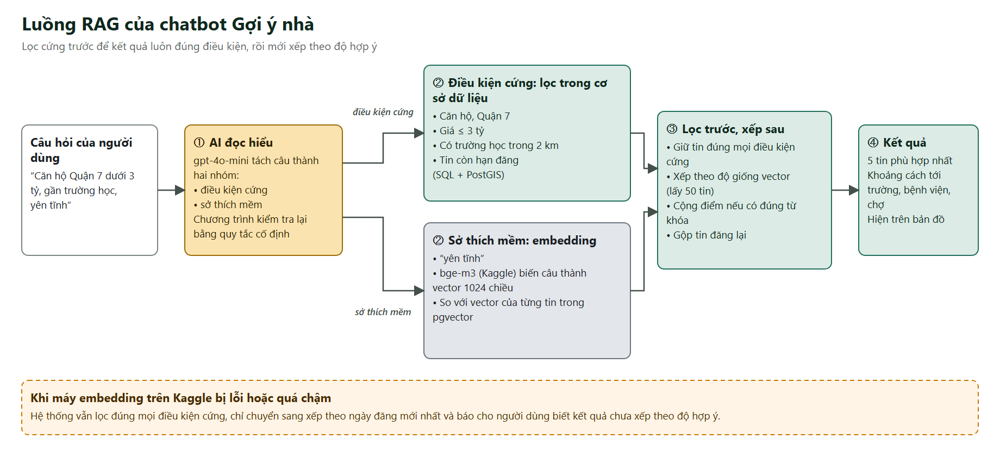
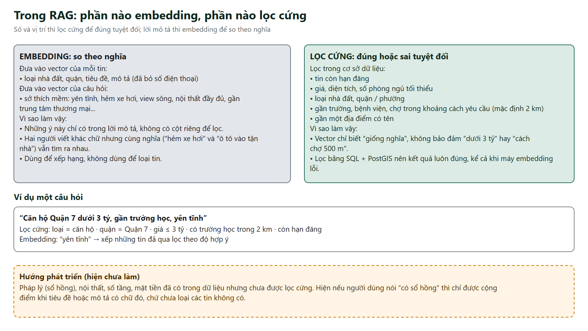
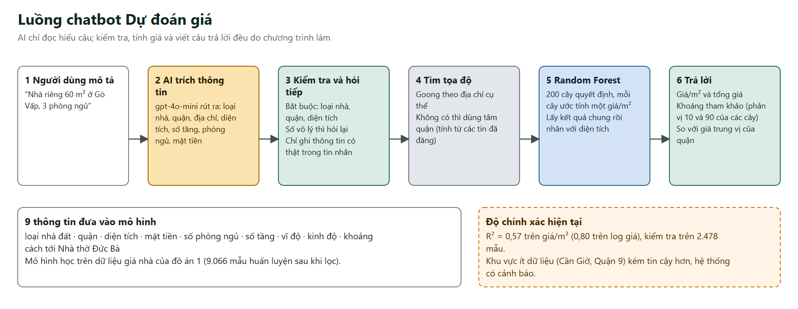
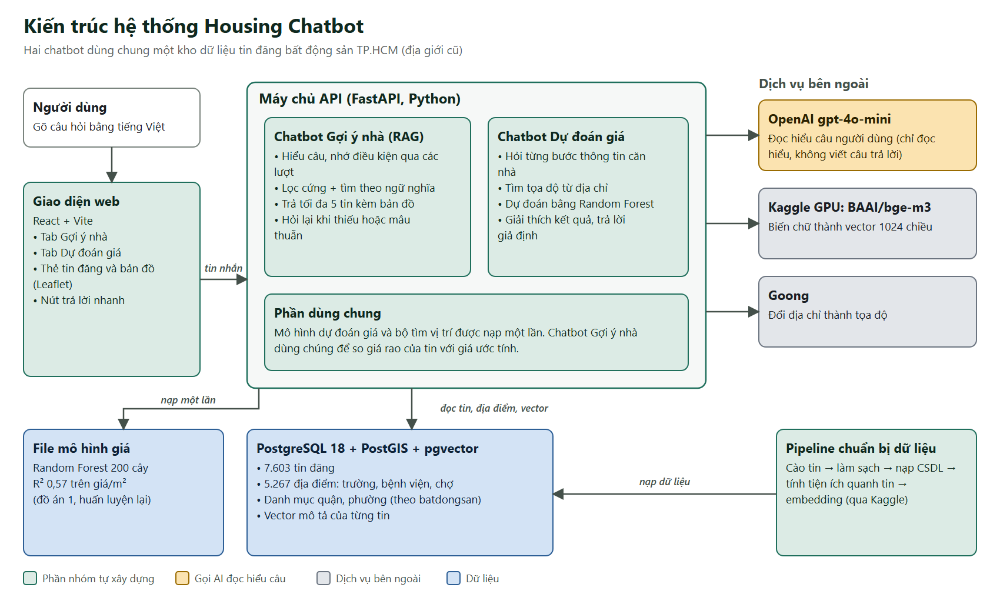

# Báo cáo tiến độ Đồ án 2, lần 2

Kính gửi cô,

Nhóm chúng em xin báo cáo tiến độ lần 2 của Đồ án 2. So với lần 1 (đã cào xong dữ liệu tin đăng và dữ liệu tiện ích), nhóm đã hoàn thành phần làm sạch và lưu trữ dữ liệu, xây dựng hai chatbot, và có giao diện web để chạy thử.

## 1. Những việc đã hoàn thành

1. **Cơ sở dữ liệu:** thiết kế lại toàn bộ trên PostgreSQL (kèm PostGIS để tính khoảng cách và pgvector để tìm theo ngữ nghĩa). Danh mục quận, phường lấy theo chính hệ thống địa chỉ của batdongsan, có bảng đối chiếu phường cũ sang phường mới.
2. **Làm sạch và nạp dữ liệu:** đã chạy được trọn pipeline: tin đăng thô → làm sạch (chuẩn hóa số liệu, đánh dấu giá trị bất thường, bỏ tin trùng) → lưu vào cơ sở dữ liệu → tính tiện ích quanh từng tin. Chạy lặp lại nhiều lần không làm trùng hay thay đổi dữ liệu. Hiện có **7.603 tin đăng** và **5.267 địa điểm** (trường học, bệnh viện, chợ).
3. **Chatbot Gợi ý nhà (RAG):** người dùng nói nhu cầu bằng tiếng Việt, hệ thống nhớ điều kiện qua nhiều lượt hội thoại và trả tối đa 5 tin phù hợp kèm bản đồ. Phần 2 bên dưới giải thích chi tiết.
4. **Chatbot Dự đoán giá:** hỏi từng bước thông tin căn nhà rồi ước tính giá bằng mô hình học máy. Phần 3 bên dưới giải thích chi tiết.
5. **Giao diện web demo:** có hai tab (Gợi ý nhà, Dự đoán giá), thẻ tin đăng và bản đồ hiển thị tin cùng trường học, bệnh viện, chợ xung quanh.
6. **Kiểm thử:**
   - Chatbot Gợi ý nhà được chạy trên bộ 50 kịch bản hội thoại nhiều lượt (174 lượt). Điều kiện cứng (giá, khu vực, loại nhà...) đúng ở 100% số lượt, và 100% tin trả về còn hạn đăng.
   - Chatbot Dự đoán giá được chạy trên 20 tình huống thực tế: 18 đạt hoàn toàn, 1 đạt ở mức biên, 1 là giới hạn đã biết (huyện Cần Giờ có ít dữ liệu).

## 2. Chatbot Gợi ý nhà: phần nào embedding, phần nào lọc cứng

Chatbot dùng kỹ thuật RAG: thay vì để AI tự nghĩ ra tin, hệ thống **tìm các tin thật trong cơ sở dữ liệu** rồi trình bày lại. Việc tìm được chia thành hai nhóm với hai cách xử lý khác nhau.

**Phần lọc cứng (đúng hoặc sai tuyệt đối), thực hiện ngay trong cơ sở dữ liệu:**

- tin còn hạn đăng
- giá, diện tích, số phòng ngủ tối thiểu
- loại nhà đất, quận / phường
- gần trường học, bệnh viện, chợ trong khoảng cách người dùng yêu cầu (mặc định 2 km)
- gần một địa điểm có tên

**Phần embedding (so theo nghĩa):**

- Với mỗi tin: loại nhà đất, quận, tiêu đề và mô tả (đã bỏ số điện thoại) được biến thành một dãy 1.024 số (vector) và lưu trong pgvector.
- Với câu hỏi: chỉ phần *sở thích mềm* được biến thành vector, ví dụ "yên tĩnh", "hẻm xe hơi", "view sông", "nội thất đầy đủ".

**Vì sao làm như vậy:**

- Giá, diện tích, khoảng cách là con số, còn vector chỉ biết "giống nghĩa", không đảm bảo "dưới 3 tỷ" hay "cách chợ 500 m". Vì vậy các điều kiện này phải lọc cứng để kết quả luôn đúng, kể cả khi máy chạy embedding gặp sự cố.
- Những ý như "yên tĩnh" hay "hẻm xe hơi" chỉ có trong lời mô tả, không có cột dữ liệu riêng để lọc. Embedding giúp tìm đúng tin dù người đăng viết khác chữ nhưng cùng nghĩa.
- Quy trình là **lọc trước, xếp sau**: giữ lại các tin đúng mọi điều kiện cứng, sau đó xếp theo độ giống với sở thích mềm (kết hợp cộng điểm khi tin có đúng từ khóa), gộp các tin đăng lại gần như giống hệt nhau và lấy 5 tin đầu. Khi ít hơn 5 tin, hoặc không có tin nào, chatbot đề xuất nới từng điều kiện và cho biết sẽ tìm được bao nhiêu tin.
- Nếu máy embedding gặp lỗi, hệ thống vẫn lọc đúng mọi điều kiện cứng, chỉ chuyển sang xếp theo ngày đăng mới nhất và báo cho người dùng biết.
- AI chỉ dùng ở một bước: đọc hiểu câu của người dùng. Sau đó chương trình kiểm tra lại bằng quy tắc cố định, còn việc tìm kiếm và viết câu trả lời đều do chương trình làm từ số liệu trong cơ sở dữ liệu, nên không bịa thông tin.

*Hướng phát triển:* pháp lý (sổ hồng), nội thất, số tầng đã có trong dữ liệu nhưng chưa được lọc cứng. Hiện nếu người dùng nói "có sổ hồng" thì các tin có chữ đó được cộng điểm, chứ chưa loại các tin không có.

## 3. Chatbot Dự đoán giá

Người dùng mô tả căn nhà (ví dụ "nhà riêng 60 m² ở Gò Vấp, 3 phòng ngủ"). Chatbot hỏi tiếp những thông tin còn thiếu. Ba thông tin bắt buộc là loại nhà, quận và diện tích. Mặt tiền, số tầng, phòng ngủ và địa chỉ giúp kết quả sát hơn. Sau đó chatbot đổi địa chỉ thành tọa độ (qua Goong, nếu không có thì dùng tâm quận) rồi đưa vào mô hình.

Kết quả gồm giá mỗi m², tổng giá và một khoảng tham khảo (lấy từ mức thấp và mức cao trong số các cây của mô hình), kèm lưu ý đây là ước tính chứ không phải giá giao dịch. Người dùng có thể hỏi giả định ("nếu thêm một tầng thì giá thế nào?"), hỏi vì sao ra mức giá này, hoặc so sánh hai quận. Chatbot Gợi ý nhà cũng dùng mô hình này để so giá rao của một tin với giá ước tính.

**Độ chính xác hiện tại:** R² = 0,57 trên giá/m² (0,80 trên log giá), kiểm tra trên 2.478 mẫu. Khu vực ít dữ liệu như Cần Giờ và Quận 9 kém tin cậy hơn, hệ thống có cảnh báo trong câu trả lời. Đây là mô hình kế thừa từ Đồ án 1, nhóm chưa cải tiến.

## 4. Các mô hình và công nghệ đang dùng

| Việc | Mô hình / công nghệ | Ghi chú |
|---|---|---|
| Biến văn bản thành vector | **BAAI/bge-m3** (1.024 chiều, hỗ trợ hơn 100 ngôn ngữ, nhận văn bản dài) | Chạy trên GPU Kaggle, máy chủ chỉ gọi qua API |
| Đọc hiểu câu người dùng | **OpenAI gpt-4o-mini** | Chỉ để hiểu câu, không viết câu trả lời |
| Dự đoán giá | **Random Forest** (200 cây quyết định) | Học từ dữ liệu giá nhà của Đồ án 1, 9 thông tin đầu vào |
| Đổi địa chỉ thành tọa độ | **Goong** | Không có thì dùng tâm quận |
| Cơ sở dữ liệu | **PostgreSQL 18 + PostGIS + pgvector** | Lọc theo vị trí và tìm theo vector |
| Máy chủ và giao diện | **FastAPI** (Python), **React + Vite**, bản đồ **Leaflet** | |

## 5. Kiến trúc hệ thống hiện tại

Người dùng chat trên giao diện web. Tin nhắn được gửi tới máy chủ API, máy chủ chuyển đến đúng chatbot theo tab đang chọn. Cả hai chatbot đều gọi OpenAI để đọc hiểu câu, rồi tự xử lý tiếp bằng chương trình của nhóm. Chatbot Gợi ý nhà truy vấn cơ sở dữ liệu và gọi máy embedding trên Kaggle. Chatbot Dự đoán giá gọi Goong và mô hình Random Forest. Hai chatbot dùng chung mô hình giá và bộ tìm vị trí. Bên cạnh đó, pipeline chuẩn bị dữ liệu chạy riêng, không nằm trong lúc người dùng chat.

## 6. Khó khăn và việc tiếp theo

- **Dữ liệu tin đăng cần cập nhật:** dữ liệu cào đến ngày 21/09, đến nay phần lớn tin đã hết hạn đăng. Chatbot chỉ gợi ý tin còn hạn nên nhóm sẽ thiết lập cào dữ liệu định kỳ.
- **Mô hình dự đoán giá:** nhóm sẽ thêm thông tin tiện ích xung quanh (số trường học, bệnh viện, chợ trong bán kính 1 km và 3 km) vào mô hình để cải thiện độ chính xác.
- **Hoàn thiện giao diện và kiểm thử đầu cuối:** kiểm thử toàn bộ luồng từ giao diện đến cơ sở dữ liệu, chuyển sang cơ sở dữ liệu chính thức và hoàn thiện bản đồ.
- **Mở rộng lọc cứng:** thêm pháp lý, nội thất, số tầng.

Em gửi cô báo cáo để cô nắm được tiến độ của nhóm. Em cảm ơn cô.
